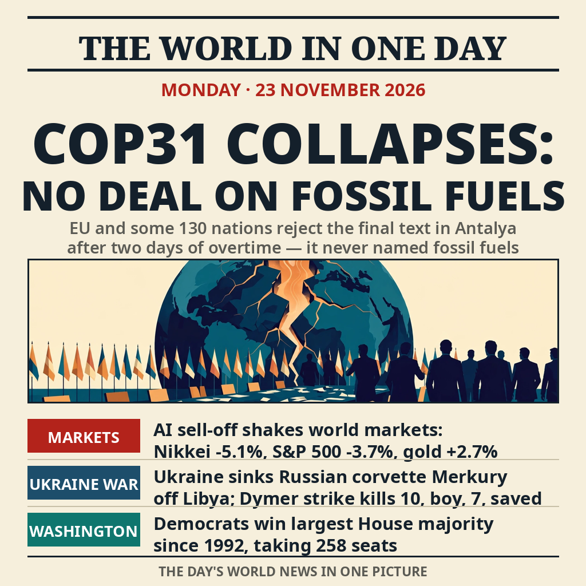

# The World in One Day — 23 November 2026

A front page in one picture, built for the make.fun
[news-image-20261123](https://make.fun/bounty/news-image-20261123) bounty:
sum up Monday 23 November 2026's world news in a single image.



## What the picture says

- **Lead — COP31 collapses.** The climate summit in Antalya, Turkey ended
  with no deal after two days of overtime: the EU and some 130 nations
  rejected a final text that never named fossil fuels. The illustration —
  a cracked, burning globe above an abandoned summit table — is drawn for
  this entry; every word on the page is set as type, not painted, so the
  headlines stay crisp.
- **Markets.** An AI sell-off shook world markets: Japan's Nikkei fell
  5.1%, the S&P 500 fell 3.7%, and gold rose 2.7% as investors ran to safety.
- **Ukraine war.** Ukraine said its naval drones sank the Russian corvette
  Merkury off Libya and hit the cargo ship MV Angara; a Russian strike on
  Dymer, north of Kyiv, killed at least 10 people, and rescuers pulled a
  boy of 7 alive from the rubble.
- **Washington.** Democrats secured 258 House seats, their largest majority
  in the chamber since 1992.

Stories as reported on 23 November 2026 by Reuters, the BBC and the day's
news roundups, cross-checked against each other before anything was drawn.

## How it runs

`main.ts` (Node 22, standard library only) copies the committed `entry.png`
to `/output/entry.png`. No network, no dependencies, same bytes every run —
the image is 1024 × 1024 PNG, well under the 1 MiB gate.

```sh
mkdir -p out && MAKEFUN_OUTPUT_DIR=out node main.ts
```

## License

MIT — see [LICENSE](LICENSE).
